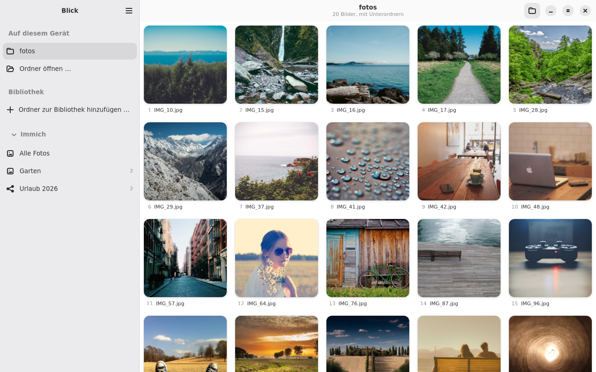
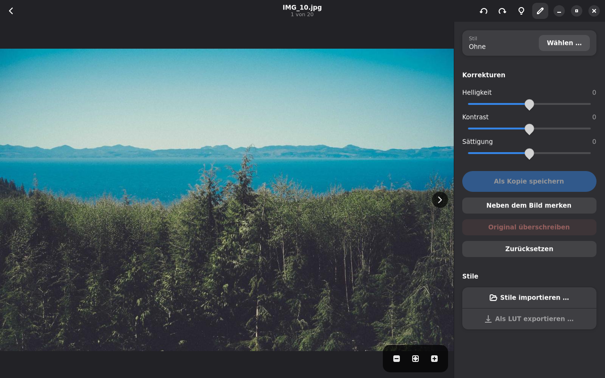
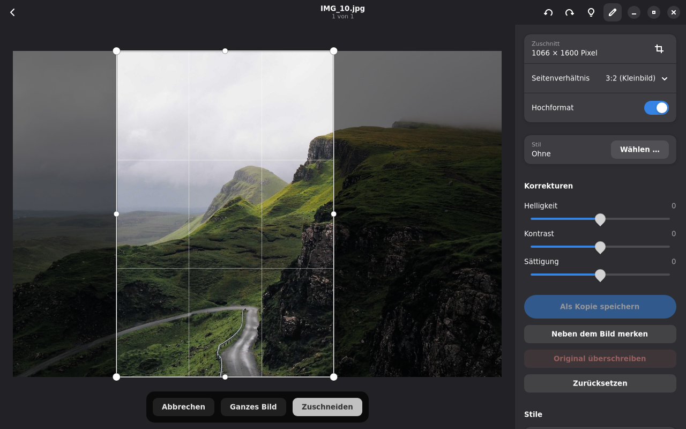

# Blick

English · [Deutsch](README.de.md)

Blick is an image viewer for GNOME, written in Rust with GTK 4 and libadwaita. A folder shows up as a contact sheet: every picture side by side, numbered in folder order. You can rotate a selection in one go, upload it to [Immich](https://immich.app), or tweak a single picture's brightness, contrast and saturation.




## What it does

The contact sheet shows the whole folder tree by default. The folder button in the header bar switches to the top level only. Thumbnails are cached in `~/.cache/blick/thumbs` and made on their own threads, most recently requested tile first. New and deleted files appear without reloading, up to 1000 folders deep.

The library is your Pictures folder (there from the first start) plus whatever you add with "Open folder", or on the command line with `blick -r ~/Photos`. Every subfolder that contains pictures becomes an album. Blick skips hidden folders, Synology's `@eaDir` and trash folders.



### Formats

Blick decodes JPEG, PNG, WebP, GIF, BMP and TIFF itself. Camera RAW (CR2, CR3, NEF, ARW, RAF, RW2, ORF, DNG and about 20 more) goes through rawler: the embedded preview for viewing, a full develop for export and zoom. Blick matches the develop's tones to the camera preview channel by channel, because otherwise the picture looks flatter than it did on the camera's screen. HEIC, AVIF, JPEG XL, SVG, EXR and more come from glycin in the GNOME runtime, which decodes each file in a sandboxed process.

Videos (MP4, MOV, MKV, WebM, AVI, 3GP, MTS and others) get a still frame and a play badge on the sheet and play in the single view. Each one starts muted and loops. There are no subtitles and no seeking, on purpose. Playback runs on the runtime's GStreamer (H.264, HEVC, AV1, VP9, with VA-API where available), and Blick honors the rotation tags that phones write. From Immich it plays the browser-friendly version the server already made.

### Single view

Previous/next and zoom buttons sit on top of the picture. Zoom with Ctrl+scroll, pinch, double-click or `+` `-` `0` `1`. F11 is fullscreen, Alt+Enter shows EXIF info. Blick preloads the neighbouring pictures in the background.

You can rotate one picture or the whole selection, with undo. JPEG rotates losslessly through the EXIF tag. RAW, HEIC, AVIF and JPEG XL get an XMP file next to them (`<file>.xmp`) and the original stays bit-identical. Other formats are re-encoded with EXIF and ICC kept. Animated GIFs are left alone.

### Cropping

Crop freely or with a preset: original, 1:1, 4:3, 3:2, 16:9, 5:4, 7:5 or 2:1, landscape or portrait. Drag the frame by its corners and edges or move it from inside. The size in pixels appears in the sidebar. Like the adjustments, a crop goes into a copy, into the original, or gets remembered in `<picture>.xmp`. If you rotate the picture afterwards, the remembered crop rotates with it.



### Adjustments and looks

Brightness, contrast and saturation have a live preview. On top of that you can apply looks from `.cube` LUTs, HaldCLUT PNGs and Lightroom presets (`.xmp`), with a strength slider. If a preset contains something Blick can't reproduce, the import tells you. Blick can also download RawTherapee's film simulations (Kodak, Fuji, Ilford and others, CC BY-SA 4.0) when you ask it to.

Save the result as a copy, remember it in a `<picture>.xmp` next to the file, or export the look as a `.cube`. One look can be applied to many pictures at once, and the contact sheet shows remembered adjustments and looks too.

### Cleaning up and duplicates

Delete moves a picture to the trash, with undo. Blick deletes permanently only inside the duplicate finder, and only when you explicitly choose it (for network shares without a trash).

The duplicate finder (main menu, Ctrl+Shift+D) is modelled on dupeGuru and lives in the `blick-dupes` crate. It has four modes: similar pictures, identical content, file names and folders. It can search local folders, network shares through GIO/gvfs (`smb://`, `sftp://`, `davs://`, `nfs://`) and the Immich library. Locations can be marked as reference, and Blick never deletes from those.

For content matching, Blick compares size first, then a blake3 hash over the start, middle and end of each file (on servers it reads only those ranges), then the full hash. For pictures it compares 15×15 colour blocks like dupeGuru and looks them up through a gradient hash split into four 16-bit stripes, instead of comparing every picture with every other. Rotated matches and different aspect ratios are optional. Immich returns SHA-1 sums with its search, and Blick checks local files of the same size against them without downloading anything. Hashes and signatures live in `~/.cache/blick/dupes.db`. To clean up, mark matches, compare them side by side, then send them to the trash (Immich's trash for Immich assets), move them, replace them with hardlinks or export a CSV.

You can switch between light and dark in the main menu, independent of the system setting.

### Immich

Blick works with [Immich](https://immich.app) 2.x and newer, tested against the 3.3.1 API. Uploads carry a checksum so the server can spot duplicates, and can go straight into an album. You page through albums and the timeline month by month, and you can download originals. In the single view, the full resolution arrives after the preview: for JPEG and similar through `size=fullsize`. For HEIC and RAW, as long as the server doesn't generate full-size images, Blick fetches the original and decodes it itself.

## Keyboard shortcuts

| Shortcut | Action |
|---|---|
| Ctrl+O | Open folder |
| Ctrl+R / Ctrl+Shift+R | Rotate selection or current picture right / left |
| Ctrl+U | Upload selection to Immich |
| Enter, double-click, Space | Open picture (Space in single view: back to the sheet) |
| Left / Right arrow | Browse in single view |
| E | Toggle editing |
| Hold left mouse button on the picture (while editing) | Show the original while held |
| S | Choose a look |
| C | Crop: arrows move the frame, with Shift they resize it, Enter applies, Esc cancels |
| `+` `-` `0` `1` | Zoom: in, out, fit, 100 % |
| Space, K (video) | Play/pause |
| M (video) | Mute/unmute |
| Up / Down arrow (video) | Louder / quieter |
| F11 | Fullscreen |
| Alt+Enter | Picture info |
| Delete | Move to trash |
| Ctrl+, | Preferences |
| Ctrl+? | All shortcuts |

## Installation

Blick runs as a Flatpak (GNOME 51). Each release on the [releases page](https://github.com/paulhoever/Blick/releases) carries a `blick.flatpak` bundle with its checksum next to it.

```sh
sha256sum -c blick.flatpak.sha256
flatpak install --user blick.flatpak
flatpak run io.github.paulhoever.Blick
```

## Setting up Immich

In [Immich](https://immich.app), create an API key under account settings. It needs `user.read`, `album.read`, `asset.read`, `asset.view`, `asset.download`, `asset.upload` and `albumAsset.create`. In Blick, enter the address and key under Preferences and press "Check and save". The key is then stored in the keyring (oo7, through the Secret portal inside the Flatpak) and the address in GSettings.

Don't test against a real account. `tools/immich_mock.py` fakes an Immich server using the pictures from any folder:

```sh
python3 tools/immich_mock.py ~/test-pictures 2291
BLICK_IMMICH_URL=http://127.0.0.1:2291 BLICK_IMMICH_KEY=demo-key cargo run
```

The two environment variables take precedence over the saved settings.

## Layout

```
crates/
  blick-core/    image handling without GTK: decoding, adjustments, rotation, caches, batch
  blick-immich/  Immich client (reqwest, rustls with ring), no GTK
  blick-dupes/   duplicate finder: sources (local, GIO, Immich), pipeline, cache, results
  blick/         the app: window, contact sheet, single view, dialogs
data/            desktop file, metainfo, GSettings schema, CSS, icons
build-aux/       Flatpak manifest and the crate list for the offline build
tools/           Immich stand-in for tests
```

Nothing in the UI thread touches files or the network. Decoding, rotating and saving run through `gio::spawn_blocking` or the thumbnail threads, and networking runs on its own tokio runtime. Results come back to the GTK main loop as futures. Each view keeps a generation counter, so a late result for a picture you've already paged away from gets dropped.

## Building

For development you need Rust 1.85 or newer plus the GTK 4.14+ and libadwaita 1.5+ development packages:

```sh
sudo apt install libgtk-4-dev libadwaita-1-dev
cargo run -- ~/Pictures
cargo test --workspace
cargo clippy --workspace --all-targets -- -D warnings
```

The Flatpak builds offline, with Rust from the SDK extension:

```sh
flatpak install --user flathub org.gnome.Sdk//51 org.freedesktop.Sdk.Extension.rust-stable//26.08
flatpak-builder --user --force-clean --install build-dir build-aux/io.github.paulhoever.Blick.yml
flatpak run io.github.paulhoever.Blick
```

After every change to `Cargo.lock`, regenerate `build-aux/cargo-sources.json`:

```sh
python3 -m venv .venv-tools && .venv-tools/bin/pip install aiohttp tomlkit
curl -LO --output-dir .venv-tools https://raw.githubusercontent.com/flatpak/flatpak-builder-tools/master/cargo/flatpak-cargo-generator.py
.venv-tools/bin/python .venv-tools/flatpak-cargo-generator.py Cargo.lock -o build-aux/cargo-sources.json
```

To make an installable bundle for other machines:

```sh
flatpak-builder --user --force-clean --repo=repo build-dir build-aux/io.github.paulhoever.Blick.yml
flatpak build-bundle repo blick.flatpak io.github.paulhoever.Blick --runtime-repo=https://dl.flathub.org/repo/flathub.flatpakrepo
```

## Limits

- HEIC, AVIF and JXL rotate only through the sidecar. Adjustments can't overwrite those files, only be saved as a copy: the HEIF encoder in the GNOME runtime writes no EXIF, so the capture date would be lost.
- The RAW tone match approximates the camera preview. It isn't the camera's tone curve, and without an embedded preview the develop stays flat.
- Lightroom computes highlights, shadows, whites and blacks locally, Blick globally. Presets look similar, not identical.
- Thumbnails following the freedesktop specification (shared with Nautilus) are missing. Inside the Flatpak that would need access to `~/.cache/thumbnails`.
- There are no translations (gettext) yet, so the interface is English only.

## License

GPL-3.0-or-later
